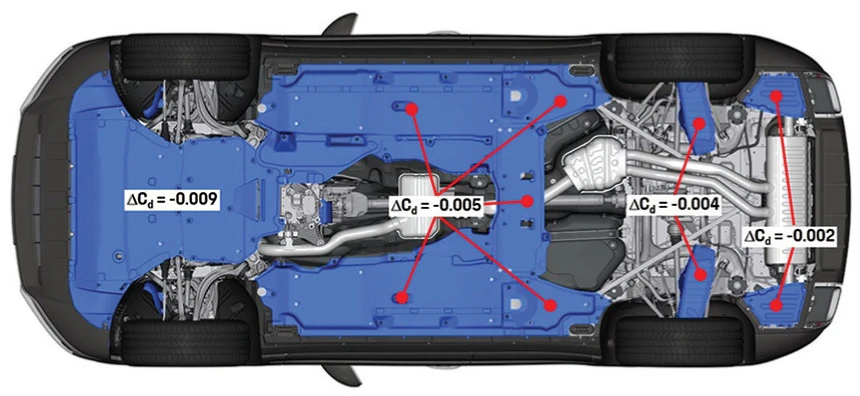

Na aerodinâmica veicular, costuma-se dar ênfase ao teto, ao aerofólio ou ao para-choque dianteiro, mas o assoalho é a região de maior impacto real. Instalar um «protetor de assoalho e cárter» bem planejado permite carenar o fundo do carro, melhorar a estabilidade em altas velocidades e economizar combustível. Embora muitos carros importados de luxo venham totalmente carenados de fábrica, vários veículos nacionais ou de entrada dispensam esse componente.

## As Três Principais Vantagens Aerodinâmicas de um Assoalho Plano

O fundo original de um carro comum sem carenagem é repleto de reentrâncias e componentes expostos: cárter de óleo, transmissão, escapamento e bandejas de suspensão. Em velocidades de rodovia, essas irregularidades criam severa turbulência.

Vejamos os dados científicos:

*(Fonte: Estudo de Aerodinâmica da Porsche)*

### 1. Redução de Arrasto: Eficiência que Pode Superar «Rodas Forjadas Leves»
Segundo estudos da Porsche, os benefícios aerodinâmicos do assoalho plano decrescem da dianteira para a traseira do carro. Logo, o protetor sob o cofre do motor é a peça mais importante para romper o fluxo de ar frontal. O simples fechamento da área sob o motor reduz o coeficiente de arrasto (Cd) em cerca de 0,009; com o fechamento integral do assoalho, o arrasto diminui em 6%.

Impactos práticos do coeficiente de arrasto:  
- **Demanda de Potência**: Cada aumento de 0,01 no Cd requer aproximadamente 1 cv adicional do motor a 100 km/h.
- **Ganho de Autonomia**: Cada redução de 0,001 no Cd aumenta a autonomia em 1 km. Reduzir o Cd de 0,35 para 0,30 pode render até 50 km extras de alcance.

Frente ao alto custo de rodas forjadas aliviadas, a instalação do protetor de assoalho oferece uma relação custo-benefício muito mais expressiva em economia de combustível e redução de ruído de vento.

### 2. Redução de Sustentação e Fim da Sensação de «Flutuação»
Além de cortar o arrasto, o fechamento do assoalho controla a sustentação aerodinâmica positiva ($$C_l$$). Aquela sensação de instabilidade ou flutuação ao trocar de faixa em velocidade elevada costuma ser amplificada pelas rajadas de ar sob o chassi irregular.

* **Combate a Ventos Laterais**: Ensaios mostram que sob ventos laterais, a sustentação de um assoalho plano é substancialmente menor que a de um assoalho aberto.
* **Efeito Solo**: Com base no princípio de Bernoulli, o ar que passa velozmente sob uma chapa lisa cria uma região de baixa pressão que «suga» o carro contra o asfalto, elevando a aderência sem adicionar peso físico suspenso.

### 3. Otimização Térmica do Cofre do Motor
Muitos acreditam intuitivamente que fechar o vão sob o motor vai sufocar o arrefecimento. Isso é um equívoco. Uma troca térmica eficiente não depende de espaço aberto e desordenado, mas sim do direcionamento do fluxo de ar:

* **Efeito de Extração em Alta Velocidade**: O fluxo veloz sob o carro plano gera baixa pressão, atuando como um exaustor que suga ativamente o ar quente para fora por aberturas direcionadas na chapa. A eficiência supera em muito o chassi aberto, onde o ar turbulento dispersa o calor desordenadamente.
* **Direcionamento em Baixa Velocidade**: No trânsito lento, o arrefecimento depende das ventoinhas. O protetor atua como um defletor, usando a pressão positiva dos eletroventiladores para guiar o ar quente em direção à traseira, evitando que o calor retorne ao motor após rebater no solo.

## Aço-Plástico vs Metal: Como Escolher?

O mercado oferece atualmente duas grandes categorias: «Aço-Plástico (Polímeros Compostos PP/PE/ABS)» e «Metal (Liga de Alumínio ou Aço Manganês)»:

| Aspecto | Aço-Plástico (Polymer Steel) | Metal (Alumínio / Aço Manganês) |
| :--- | :--- | :--- |
| **Peso** | **Ultraleve**. Praticamente não adiciona peso à carroceria. | **Mais pesado**. O aço é o mais pesado, seguido do alumínio. |
| **Nível de Proteção** | **Moderado**. Protege contra água, lama, brita e raspadas superficiais. | **Altíssimo**. Suporta impactos severos contra pedras e quebra-molas altos. |
| **Resiliência e Deformação** | **Flexível**. Recupera a forma após impactos leves; trinca sob pancada extrema. | **Inelástico**. Sofre deformação permanente e amassados sob impacto forte. |
| **Conforto Acústico (NVH)** | **Excelente**. Absorve ruídos e não gera ressonâncias sonoras. | **Inferior**. Reflete o som e pode chiar se mal parafusado. |
| **Indicação de Uso** | **90% dos motoristas urbanos**, rodovias e estradas pavimentadas. | **Off-road**, trilhas rurais, estradas esburacadas de terra. |

**Recomendação de Compra:**
Para quem utiliza o carro no **dia a dia e em viagens por rodovias, priorizando menor consumo, menos ruído e aerodinâmica**, o **aço-plástico** é a escolha ideal pela leveza e funcionamento silencioso. Já quem encara **estradas de terra, pedras e risco constante de bater o cárter**, deve recorrer às chapas de **alumínio ou aço**.

## Afinal: O Protetor Rígido Prejudica a Queda do Motor em Batidas?

Ao cogitar chapas metálicas resistentes, surge um receio clássico: *«Em colisões frontais graves, o motor é projetado para cair sob a carroceria (Engine Dropping Design). Uma chapa de ferro não vai impedir o motor de cair e empurrá-lo contra as pernas do motorista?»*

Esse medo parece plausível à primeira vista, mas é infundado quando confrontado com a física:

* **Disparidade de Forças:** Em uma colisão frontal séria, a força de cisalhamento inercial para romper os suportes do motor supera **10 toneladas**. Os protetores são fixados ao subchassi por parafusos pequenos M6 ou M8.
* **Resistência Insignificante:** Quando uma massa sob 10 toneladas de energia cinética desce, essas pequenas roscas são arrancadas no mesmo milissegundo e a chapa se rasga como folha de papel. A resistência mecânica do protetor é insignificante diante da energia do choque.

Em resumo, a rigidez da chapa serve perfeitamente para suportar pedregulhos e valetas, mas não possui força física para reter o peso e a inércia do motor em um acidente em alta velocidade.

## Conclusão

O protetor de cárter e assoalho não é apenas uma couraça mecânica, mas uma ferramenta aerodinâmica vital para economizar combustível e conferir estabilidade dinâmica ao veículo. Escolhendo o material adequado às suas rotas, você usufruirá de uma condução muito mais estável e eficiente!
