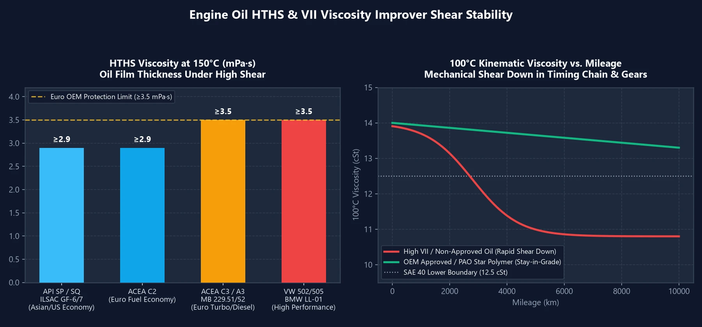

Em análises técnicas anteriores, demonstramos que **o HTHS define a troca entre economia de combustível e proteção em altas rotações**, e que **o Índice de Viscosidade (VI) isolado não garante a qualidade de um lubrificante**.

Muitos motoristas ainda se perguntam: por que dois óleos com rótulo **`5W-30`** transmitem sensações ao volante completamente diferentes? E por que certos óleos badalados rodam macios pelos primeiros $$2000$$ km e ficam barulhentos e pesados logo após os $$3000$$ km? A explicação reside em duas variáveis técnicas fundamentais: **HTHS** e **VII**.

---

## 1. Viscosidade HTHS: A Espessura Real da Película sob Condições Severas

A classificação `5W-30` estampada no frasco descreve exclusivamente a viscosidade cinemática mensurada a $$100^\circ\text{C}$$. Em regime de alta potência, a temperatura entre os anéis do pistão e as paredes do cilindro sobe para **$$150^\circ\text{C}$$**, onde o fluido sofre milhões de ciclos de cisalhamento por segundo.

O parâmetro **HTHS (High Temperature High Shear)** afere a espessura hidrodinâmica real a **$$150^\circ\text{C}$$ sob estresse de cisalhamento extremo** (expressa em $$\text{mPa}\cdot\text{s}$$ ou $$\text{cP}$$). Esse índice segmenta os óleos `5W-30` em dois universos técnicos:

| Categoria 5W-30 | Especificação HTHS | Homologações Típicas | Características e Aplicação Ideal |
| :---: | :---: | :--- | :--- |
| **Baixo HTHS** **(Película Fina・Economia)** | **$$2.9 \sim 3.1$$** | API SP / SQ, ILSAC GF-6 / GF-7 ACEA A5/B5, **ACEA C2** | Resposta ágil do acelerador, baixo atrito hidrodinâmico, máxima eficiência energética. Ideal para **veículos asiáticos, americanos e híbridos**. |
| **Alto HTHS** **(Película Espessa・Proteção)** | **$$\ge 3.5$$** | ACEA A3/B4, **ACEA C3** MB 229.5 / 229.51 / 229.52 BMW LL-01 / LL-04, VW 504/507 | Película resistente a impactos, proteção extrema contra desgaste. Indispensável para **motores turbo europeus, veículos diesel com DPF e carros esportivos**. |

> **Regra Importante de Aplicação**:  
> Utilizar um lubrificante `ACEA C3` ($$\text{HTHS} \ge 3.5$$) em um carro popular asiático naturalmente aspirado não causará quebras, mas resultará em **respostas mais lentas ao pedal e discreto aumento no consumo**. Já colocar um óleo `API SP / ILSAC GF-6` ($$\text{HTHS} \approx 2.9$$) em um motor turbo europeu que exige $$\text{HTHS} \ge 3.5$$ provocará desgaste prematuro acentuado em **comandos de válvulas e cilindros** sob exigência contínua na estrada!

---

## 2. VII (Polímeros Melhoradores de Viscosidade): A Degradação aos 3.000 km

Para formular lubrificantes multiviscosos como `5W-30` ou `0W-40`, as fábricas utilizam um **óleo básico fluido** (para garantir a partida a frio) adicionado de **polímeros VII** (cadeias moleculares flexíveis em forma de espiral):
- **A frio**: As cadeias poliméricas se enrolam em esferas compactas, permitindo que o óleo fino flua livremente.
- **A quente**: As cadeias se expandem e se entrelaçam em rede, engrossando artificialmente o óleo fino para alcançar a viscosidade de grau 30 ou 40.

### O Que É a «Quebra por Cisalhamento Mecânico» (Shear Down)?

Conforme o lubrificante circula pela **corrente de sincronismo, bomba de óleo, comandos e anéis de pistão**, essas cadeias poliméricas expandidas são fisicamente cortadas e rompidas como se fossem barbantes sob tesouras!

- **Óleos Econômicos ou Inflados (Bases inferiores + excesso de VII barato)**: Para ostentar números chamativos de VI ($$\text{VI} > 190$$), fabricantes de baixo custo sobrecarregam o produto com polímeros lineares frágeis. O motor roda suave de início, mas entre $$3000\sim 5000$$ km essas cadeias são estraçalhadas. O óleo retorna à sua base rala de baixa qualidade, gerando uma **queda expressiva no HTHS e na viscosidade**—a verdadeira razão pela qual o motor passa a bater e chiar.
- **Óleos Sintéticos Certificados por Montadoras (Bases PAO/GTL + polímeros estrela)**: Fórmulas premium utilizam bases nobres (**PAO / GTL**) que mantêm naturalmente sua viscosidade a quente sem excesso de aditivos, além de empregarem «Star Polymers» (polímeros em estrela) de altíssima resistência estrutural, mantendo a proteção estável além de $$10000$$ km.

---

## 3. As Três Regras de Ouro na Escolha do Lubrificante

1. **Identifique a «Categoria HTHS» Recomendada pela Montadora**:
   - **Asiáticos, americanos e híbridos**: Escolha óleos econômicos de baixo atrito `API SQ / SP`, `ILSAC GF-7 / GF-6` ou `ACEA C2` ($$\text{HTHS} \approx 2.9$$).
   - **Turbos e diesels europeus**: Exija sempre proteção robusta com homologações `ACEA C3` ou `A3/B4` ($$\text{HTHS} \ge 3.5$$).
2. **Exija Homologações Oficiais de Montadoras (OEM Approvals)**:
   Óleos com aprovações formais como `MB 229.5 / 229.51 / 229.52`, `VW 504/507`, `BMW LL-04` ou `Porsche A40` passam por severos testes de estabilidade em injetores sob alta pressão (Stay-in-Grade), atestando que a viscosidade não sofrerá colapso precoce.
3. **Não Persiga Valores Exagerados de Índice de Viscosidade (VI)**:
   Bons óleos sintéticos `5W-30` possuem VI real entre $$160 \text{ e } 175$$. Qualquer marca sem certificação que divulgar $$\text{VI} > 190$$ ou $$200+$$ frequentemente usa espessantes instáveis que se deterioram rapidamente.
