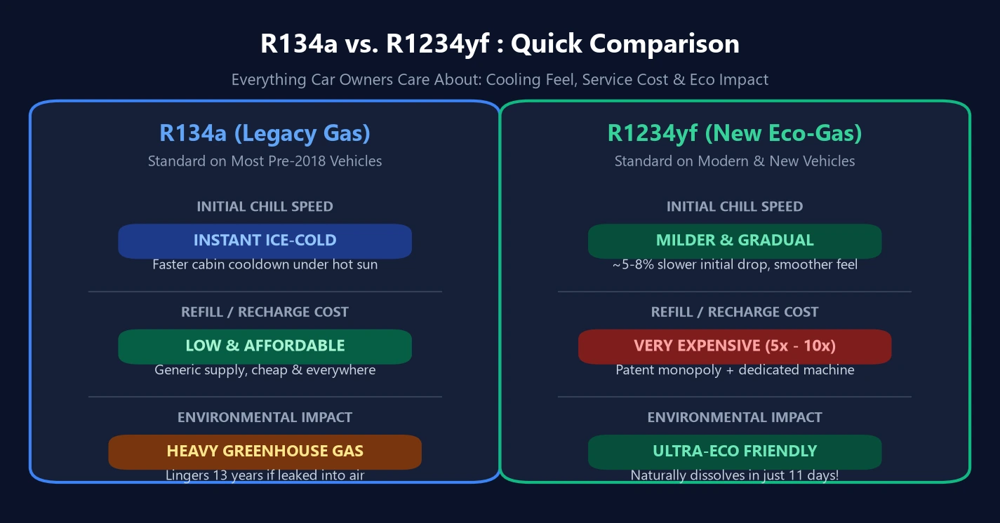

Ao levar um automóvel seminovo ou zero-quilômetro para fazer a manutenção do ar-condicionado, muitos proprietários levam um susto com o orçamento: enquanto completar a carga de um veículo antigo com **`R134a`** custa pouco, a recarga do moderno **`R1234yf`** atinge valores astronômicos!

E o mais intrigante: mesmo pagando caro pelo fluido ecológico de última geração, muitos motoristas têm a impressão de que o ar da cabine demora mais para ficar congelante sob o sol escaldante do verão. É apenas impressão ou existe explicação na física termodinâmica? Explicamos tudo de forma transparente.

---

## 1. Comparativo de Especificações: Por Que a Mudança Foi Obrigatória?

A evolução dos gases refrigerantes automotivos é pautada por exigências ecológicas globais:
- **1ª Geração R12 (CFC)**: Capacidade de refrigeração fantástica, mas destruía a camada de ozônio; banido nos anos 1990.
- **2ª Geração R134a (HFC)**: Não agride a camada de ozônio ($$\text{ODP} = 0$$), mas é um **potente gás de efeito estufa**.
- **3ª Geração R1234yf (HFO)**: O padrão compulsório atual em veículos novos na Europa, Estados Unidos e Ásia.

| Parâmetro de Comparação | Legado: R134a | Moderno: R1234yf | Impacto Real para o Motorista |
| :---: | :---: | :---: | :--- |
| **Sensação Térmica Inicial** | **Frio instantâneo e agressivo** | **Ligeiramente mais suave ($$5\% \sim 8\%$$ mais lento de início)** | O fluido antigo absorve calor mais depressa; sistemas novos usam condensadores maiores para compensar, mas o sopro inicial é menos bruto. |
| **Impacto Ecológico (Motivo da troca)** | Forte gás de estufa (permanece $$13\text{ anos}$$ no ar) | **Ultraecológico (decompõe-se em apenas $$11\text{ dias}$$)** | Banido por leis ambientais; o novo gás agride menos o clima que o próprio dióxido de carbono ($$\text{CO}_2$$). |
| **Custo de Manutenção** | **Acessível e amplamente disponível** | **Muito elevado ($$5 \sim 10\times$$ mais caro)** | Patentes controladas por gigantes químicas mundiais e síntese complexa encarecem a matéria-prima. |
| **Equipamento de Oficina** | Manômetros e recolhedoras comuns | Exige estações blindadas à prova de faísca | A leve inflamabilidade e o alto valor do gás exigem maquinário especializado e hermético. |

---

## 2. Por Que Existe a Queixa de que «Demora Mais para Gelar»?

A sensação de que os carros novos não jogam aquele ar imediatamente congelante não é psicológica. Tem fundamento em dois pilares físicos:

1. **Obstáculo Termodinâmico: Menor Calor Latente**  
   O ciclo de ar-condicionado automotivo depende da fervura do fluido líquido no evaporador para absorver o calor da cabine. O R1234yf apresenta **$$5\% \sim 8\%$$ a menos de calor latente de vaporização** em relação ao R134a. Com o compressor girando no mesmo deslocamento, ele puxa menos calorias por segundo.
2. **Compensações Feitas pela Engenharia Automotiva**  
   Para contornar esse déficit térmico, os veículos modernos adotam **condensadores frontais maiores**, **trocadores de calor internos (IHX)** e compressores eletrônicos de fluxo variável. A temperatura final estabilizada da cabine é rigorosamente a mesma, mas aquele primeiro impacto gelado nos minutos iniciais é menos cortante.

---

## 3. Por Que Esse Gás é Tão Absurdamente Caro?

Dois pilares técnicos e mercadológicos justificam o valor:

1. **Monopólio de Patentes Globais**  
   O R1234yf foi desenvolvido e patenteado conjuntamente pelos conglomerados norte-americanos **Honeywell** e **Chemours (antiga DuPont)**. As restrições de patentes e a síntese química em múltiplas etapas impedem a entrada de fabricantes genéricos para baratear o insumo.
2. **Normas Rígidas de Segurança e Estações Antichama**  
   Classificado como **A2L (levemente inflamável)**, a legislação proíbe o manuseio com ferramentas improvisadas. As oficinas precisam investir dezenas de milhares de reais em estações de recarga automáticas estanques, com sensores de vazamento e motores blindados à prova de faíscas.

---

## 4. Três Cuidados Essenciais com o Ar-Condicionado

1. **Olhe a Etiqueta sob o Capô: Jamais Misture Fluidos!**  
   A travessa superior do radiador contém uma etiqueta com o gás indicado. **Nunca permita que uma oficina recarregue um sistema R1234yf com o barato R134a**. As válvulas de expansão, as pressões e principalmente o óleo lubrificante são incompatíveis (Denso exige ND-OIL 8 para R134a e prescreve o exclusivo ND-OIL 12 para R1234yf). Misturar estraga a lubrificação e funde o compressor!
2. **Exija Recarga Exata por Balança Digital (em Gramas)**  
   Os sistemas modernos operam com tolerâncias críticas: uma variação de apenas $$30\text{ gramas}$$ prejudica a refrigeração. Fuja de oficinas que colocam gás «no olhômetro» medindo só a pressão do manômetro; exija recarga por peso conforme a etiqueta de fábrica.
3. **Gás de Ar-Condicionado Não «Acaba» Sozinho**  
   O circuito de climatização é um sistema hermeticamente fechado. Se o rendimento caiu, há um **microvazamento** em anéis de vedação, condensador ou mangueiras. Recarregar o caro R1234yf sem testar a estanqueidade e sanar o vazamento é jogar dinheiro no lixo.
