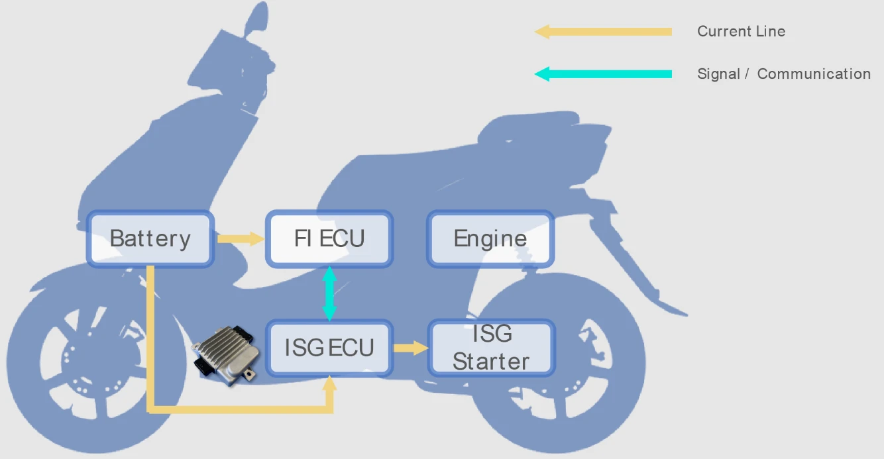

Nos últimos anos, marcas tradicionais de motocicletas e scooters (como SYM, Kymco e Yamaha) passaram a equipar seus modelos com a tecnologia **ISG (Integrated Starter Generator)**. Além de propiciar uma partida silenciosa e o sistema Start & Stop no tráfego urbano, a **assistência de torque elétrico (Motor Assist / Híbrido Leve)** tornou-se um importante diferencial dinâmico.

Contudo, muitos motociclistas notam que, com a bateria original de chumbo-ácido, o empurrão elétrico da arrancada parece discreto. Já ao instalar uma **bateria de fosfato de ferro-lítio (LiFePO4)**, a sensação de tração ao abrir o acelerador aumenta notavelmente. O que explica esse fenômeno eletrotécnico? E quais são as barreiras físicas que nenhuma bateria consegue ultrapassar? Analisamos tudo em detalhes.

---


*Fonte da imagem: [Shindengen](https://www.shindengen.com/products/electro/exhibition/private_exhibition/isg_ecu/)*

## O Que É o ISG? Princípio de Funcionamento e Papéis Duplos

Nas motocicletas convencionais, o motor de arranque e o estator do alternador são peças separadas. Na partida, o motor de arranque gira o virabrequim por meio de engrenagens e placa de partida, produzindo estalos metálicos altos e vibrações.

**O ISG unifica esses componentes em um conjunto sem escovas (brushless)** montado diretamente na ponta do virabrequim do motor a combustão. Ele atua em três regimes distintos:

1. **Modo Partida Silenciosa (Motor)**: Utilizando energia da bateria, gira o virabrequim diretamente. Sem engrenagens intermediárias, a ignição ocorre em frações de segundo, sem ruído nem trancos.
2. **Modo Assistência Elétrica (Boost Motor)**: Nas arrancadas ou acelerações vigorosas, o controlador aciona o ISG para entregar torque adicional no virabrequim, compensando a deficiência de torque do motor monocilíndrico em baixas rotações.
3. **Modo Geração e Regeneração de Energia (Gerador)**: Em velocidade constante ou nas desacelerações, o ISG atua como gerador, convertendo o movimento mecânico e o freio-motor em eletricidade para carregar a bateria de bordo.

## Limitações Físicas Inerentes ao Sistema ISG

Embora proporcione respostas mais ágeis, o ISG de motocicletas é bem diferente de sistemas híbridos de 48V ou veículos 100% elétricos, sofrendo limitações estritas:

* **O Gargalo da Baixa Tensão em 12V**: Conforme a lei da potência $$P = V \times I$$, para produzir 1 kW (cerca de 1,35 cv) de torque elétrico em uma rede de 12V, a corrente drenada da bateria supera **90 a 100 Ampères** após as perdas do inversor e do motor. Exigir potências superiores elevaria a corrente a níveis perigosos para a fiação original.
* **Espaço Confinado e Calor do Bloco**: O estator do ISG trabalha acoplado ao cárter do motor, exposto a temperaturas superiores a 90°C. O uso prolongado de assistência de alta potência superaqueceria as bobinas, podendo queimar o verniz do enrolamento ou desmagnetizar os ímãs permanentes.
* **Duração Limitada do Auxílio**: Para proteger a bateria contra descargas profundas e evitar o superaquecimento do estator, a central ECU original programa a assistência elétrica para atuar apenas nos primeiros 10 a 20 segundos de aceleração.

## Chumbo vs LiFePO4: Por Que o Ganho Dinâmico É Tão Perceptível?

Se a moto possui limites de fábrica, por que a mera troca da bateria de chumbo por uma **bateria de LiFePO4** entrega um empurrão visivelmente superior? A resposta está em **como as propriedades químicas da bateria liberam o potencial pleno que a bateria de chumbo sufocava**.

```
【Comportamento da Tensão sob Alta Demanda de Corrente】
Chumbo Tradicional: 12.8V ──► [Alta Descarga Instantânea] ──► Queda IR para 10.0V~10.5V (Perda de Potência)
Bateria LiFePO4:    13.2V ──► [Alta Descarga Instantânea] ──► Tensão Firme em 12.5V~12.8V (Potência Plena)
```

### 1. Resistência Interna e Queda de Tensão Ôhmica (Queda IR)
* **Bateria de Chumbo-Ácido**: Apresenta resistência interna elevada. Quando o ISG puxa picos de 60 a 80 A na arrancada, a lei de Ohm ($$\Delta V = I \times R_{\text{interna}}$$) impõe uma severa **queda de tensão (queda IR)**. A voltagem nos terminais desaba de 12,8V para 10,5V ou menos, reduzindo drasticamente a potência elétrica entregue ao motor ($$P = V \times I$$).
* **Bateria LiFePO4**: Tem resistência interna até cinco vezes menor e excepcional fator C de descarga. Mesmo descarregando 100 A, sua tensão terminal mantém-se estável acima de 12,5V, garantindo que o motor ISG receba energia suficiente para desenvolver seu torque máximo de projeto.

### 2. Eficiência de Recarga e Regeneração Dinâmica
Ao desacelerar, o ISG gera pulsos rápidos de recarga. A química lenta do chumbo desperdiça parte dessa energia por não conseguir absorvê-la instantaneamente. Já as células de LiFePO4 aceitam recarga rápida em altas correntes, armazenando rapidamente a energia das desacelerações para a próxima arrancada.

| Especificação Técnica | Bateria de Chumbo Tradicional | Fosfato de Ferro-Lítio (LiFePO4) |
| :--- | :--- | :--- |
| **Resistência Interna** | Alta; sofre queda acentuada de tensão sob descarga pesada | Mínima; tensão permanece estável mesmo sob altas correntes |
| **Taxa de Descarga (C-Rate)** | Moderada; altas descargas contínuas reduzem sua vida útil | Altíssima; tolera picos instantâneos de 20C a 40C sem desgaste precoce |
| **Pico de Arrancada do ISG** | Capado pela perda de tensão; motor opera com torque reduzido | Entrega integral do torque projetado pelos engenheiros da moto |
| **Recuperação de Energia** | Lenta assimilação dos picos de corrente da desaceleração | Absorção imediata da energia cinética regenerada |
| **Peso do Conjunto** | Pesada (cerca de 3 a 4 kg) | Ultraleve (cerca de 0,8 a 1,2 kg) |

## O Limite Tecnológico Inegociável

Alguns motociclistas supõem que a bateria de LiFePO4 «aumentou os cavalos do motor». Sob o prisma da engenharia, **a bateria LiFePO4 apenas elimina a barreira da subtensão, permitindo ao sistema ISG atingir seus valores nominais de catálogo, sem alterar a potência original da mecânica**. Os ganhos encontram barreiras intransponíveis:

### 1. Limite de Amperagem do Módulo de Controle (MCU/ECU)
A corrente máxima é controlada pelos transistores MOSFET e pela programação da central da moto. Mesmo que a bateria LiFePO4 consiga entregar 200 A, se a central limitar a saída a 60 A, o motor receberá rigorosamente 60 A.

### 2. Saturação Magnética do Motor Elétrico
O motor ISG é limitado pela densidade de fluxo magnético dos ímãs e das lâminas do estator. Uma vez atingida a saturação eletromagnética, qualquer corrente excedente deixa de gerar torque e converte-se unicamente em calor térmico prejudicial.

### 3. Transmissão CVT e Características em Alta Rotação
A assistência do ISG atua diretamente no virabrequim. Na arrancada, como o câmbio CVT opera na relação mais reduzida (curta), o torque elétrico é multiplicado mecanicamente para a roda, gerando o vigoroso empurrão. Já em médias e altas velocidades, a queima de combustível do motor térmico predomina totalmente, tornando a pequena parcela elétrica quase imperceptível.

## Conclusão

O sistema de assistência elétrica ISG é uma inteligente solução de engenharia para otimizar o consumo e conferir suavidade dinâmica às motocicletas modernas.

A adoção de uma bateria LiFePO4 resolve a queda de tensão nas acelerações e permite que o motor elétrico **atinja 100% de sua capacidade técnica original**. Contudo, os limites da arquitetura de 12V, o controle da central e a dissipação térmica reforçam que o ISG foi concebido para auxílio pontual. Compreender essas variáveis permite ao piloto usufruir de arrancadas mais ágeis com total segurança e longevidade para o circuito da motocicleta.
