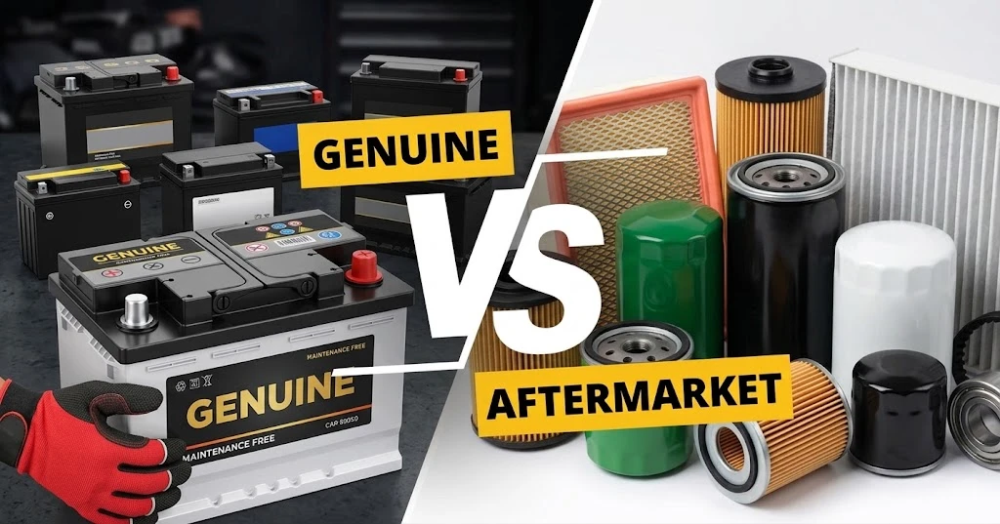

Muitos motoristas já vivenciaram a seguinte situação: após trocarem a bateria ou as pastilhas de freio em uma oficina independente de confiança, levam o carro à concessionária para uma revisão de rotina e ouvem do consultor: **«Essa peça não é original, é paralela.»** Isso gera imediata desconfiança e insegurança no condutor.

Mas afinal, o que define uma peça «Genuína»? A ausência do logo da montadora indica uma peça de segunda linha? E por que o termo «pneu paralelo» praticamente não existe no vocabulário automotivo? Esclarecemos a estrutura da cadeia de suprimentos de peças e pneus.

## 1. Peças Automotivas: Marcas, Distribuição e Mitos do Mercado

Para compreender os níveis de qualidade das autopeças, é preciso encarar uma realidade industrial: **as montadoras de automóveis não fabricam a maior parte dos componentes do carro**.

Cerca de 70% a 80% das peças de um veículo moderno (como velas, alternadores, amortecedores, módulos de freio, baterias) são desenvolvidas e fabricadas por gigantescas sistemistas de primeiro nível (Tier-1), tais como Bosch, Continental, ZF Sachs, Valeo e VARTA.

No mercado de reposição, as autopeças dividem-se em três categorias principais:

### 1. Peças Genuínas (Genuine Parts)
* **Definição**: Produzidas pelo fornecedor sistemista, homologadas pela montadora, estampadas com o **logotipo da marca do carro** e o código de peça oficial, embaladas nas caixas da montadora.
* **Características**: Vendidas quase com exclusividade nas concessionárias autorizadas. Carregam o valor mais elevado do mercado (embutindo royalties de marca e custos de rede) e possuem cobertura total da garantia de fábrica.

### 2. Peças OEM (Original Equipment Manufacturer)
* **Definição**: Fabricadas pelo **mesmíssimo fornecedor sistemista** que abastece a linha de montagem da montadora, obedecendo às mesmas tolerâncias e materiais da peça genuína, mas embaladas sob a **marca do fabricante da peça** (sem o logotipo da montadora).
* **Características**: Distribuídas no varejo de autopeças e oficinas independentes por valores de 30% a 50% inferiores aos cobrados nas concessionárias.

### 3. Peças Paralelas / Mercado de Reposição (Aftermarket)
* **Definição**: Componentes produzidos por **fábricas terceiras** que não fornecem para a linha de montagem da montadora, projetados como equivalentes dimensionais compatíveis.
* **Características**: Apresentam os preços mais baixos, mas sua durabilidade, precisão e controle de qualidade variam bastante conforme a reputação do fabricante.

## 2. O Caso Único dos Pneus: Por Que Não Existe «Pneu Paralelo»?

No setor de pneus, a dinâmica do mercado é completamente diferente: **ninguém classifica um pneu Michelin, Pirelli ou Continental como 'pneu paralelo'**.

O pneu é um componente padronizado de desgaste, e os grandes fabricantes de pneus contam com prestígio de marca e capacidade de pesquisa & desenvolvimento equivalentes ou superiores aos das montadoras. O mercado de pneus organiza-se da seguinte forma:

### 1. Pneus de Equipamento Original (OE Tires)
Os pneus montados de fábrica nas linhas de produção de carros zero-quilômetro. As montadoras firmam parcerias com as fabricantes de pneus para selecionar os compostos ideais para cada modelo.

### 2. Pneus Homologados com Marcação de Montadora
Para veículos esportivos e de luxo (Porsche, BMW, Mercedes-Benz, Audi), as fabricantes de pneus desenvolvem compostos de borracha e carcaças sob medida em parceria com os engenheiros da montadora, gravando um **código de homologação** na lateral:

* **`★` (Estrela)**: Homologado para BMW / Mini
* **`MO` / `MOE`**: Homologado para Mercedes-Benz (MOE = Run-Flat com mobilidade estendida)
* **`AO` / `RO1`**: Homologado para Audi (RO1 para modelos esportivos RS)
* **`N0` a `N6` / `NA0`**: Homologado para Porsche
* **`T0` / `T1`**: Homologado para Tesla (geralmente com espuma antirruído interna)

### 3. Pneus Universais de Reposição
Pneus de linha comum disponíveis nas revendas. Desde que obedeçam às medidas (ex: 225/45 R17), índice de carga e índice de velocidade indicados no manual do carro, oferecem segurança total e são 100% regulares.

## 3. Resumo Comparativo: Autopeças vs. Pneus

| Critério | Peças Genuínas (Montadora) | Peças OEM / Paralelas | Pneus Homologados (Código OE) | Pneus Universais de Reposição |
| :--- | :--- | :--- | :--- | :--- |
| **Definição Básica** | Peça aprovada, embalada e garantida pela montadora. | Peça sem o logo da montadora (OEM sistemista ou fabricante terceiro). | Pneu de linha de montagem ou com acerto dedicado para a marca. | Pneu padrão fabricado pelas marcas para o mercado amplo de reposição. |
| **Logotipos e Marcas** | Exibe o **logo da montadora** e código oficial. | Exibe a **marca do fabricante da peça**, sem logo de montadora. | Traz a marca do pneu e o **código de homologação** (`MO`, `★`). | Traz a marca do pneu e as **medidas universais** padrão. |
| **Canais de Venda** | Concessionárias e distribuidores oficiais. | Oficinas independentes, lojas de autopeças e distribuidores. | Concessionárias, autocentros e lojas especializadas de pneus. | Revendas de pneus, autocentros e oficinas independentes. |
| **Garantia** | Garantida pela rede autorizada da montadora. | Garantida pelo fabricante da peça ou pela oficina aplicadora. | Garantida pelo fabricante do pneu; não afeta a garantia do carro. | Garantida pelo fabricante do pneu; 100% legal e seguro. |
| **Faixa de Preço** | **Mais alta** (inclui royalties da marca e margem da concessionária). | **Econômica a moderada** (geralmente 30% a 70% da genuína). | **Média a elevada** (discreto acréscimo frente ao pneu universal). | **Variada** (do segmento econômico ao de ultra-alta performance). |

## Conclusão: Diretrizes para uma Compra Consciente

Entender essa diferenciação possibilita escolhas mais inteligentes na manutenção veicular:

1. **Durante a Garantia de Fábrica**: Para componentes vitais de motor, transmissão e eletrônica principal, a escolha de **Peças Genuínas** aplicadas na concessionária evita qualquer litígio em coberturas de garantia.
2. **Fora da Garantia ou em Itens de Desgaste**: Em itens de manutenção periódica (baterias, pastilhas, discos, filtros e velas), as **Peças OEM** de sistemistas consagrados entregam rigorosamente o mesmo padrão de qualidade com custos substancialmente menores.
3. **Na Troca de Pneus**: Adquirir pneus de fabricantes consolidados (Michelin, Pirelli, Continental, Bridgestone, Goodyear) nas medidas recomendadas atende plenamente ao uso diário. Já para veículos esportivos com suspensão ultrassensível, os pneus homologados com marcação original asseguram o comportamento dinâmico exato concebido pela montadora.
