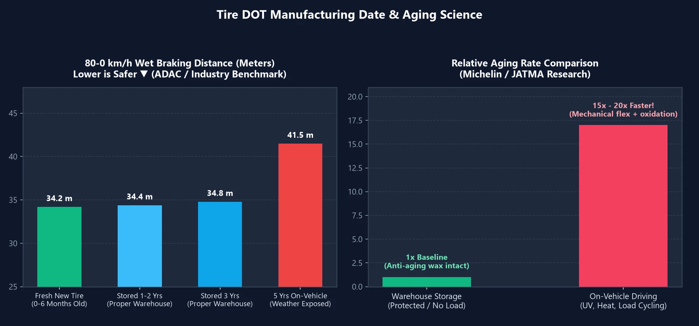

Ao comprar pneus novos, muitos motoristas se abaixam instintivamente para verificar o **código de data de fabricação `DOT`** na lateral. Se o pneu foi fabricado há apenas três meses, sentem-se aliviados; mas se foi produzido há um ou dois anos e mantido em estoque, suspeitam de imediato que a loja esteja liquidando borracha ressecada e perigosa.

Tratar pneus automotivos como caixas de leite fresco, no entanto, contraria a física dos materiais. Um pneu mantido adequadamente em estoque por 1 ou 2 anos realmente compromete a segurança? Veja o que os dados de testes internacionais comprovam.

---

## 1. Como ler a data de fabricação do pneu (código DOT) em 10 segundos

Na lateral externa do pneu, localize a sequência que começa com **`DOT`**. O último **número de 4 dígitos** gravado dentro de uma moldura oval revela o lote de fabricação:

| Exemplo de gravação | Decomposição | Significado |
| :---: | :---: | :--- |
| **`3525`** | Primeiros 2 dígitos **`35`** (semana) + Últimos 2 dígitos **`25`** (ano) | Fabricado na **35ª semana de 2025** (final de agosto de 2025) |
| **`0826`** | Primeiros 2 dígitos **`08`** (semana) + Últimos 2 dígitos **`26`** (ano) | Fabricado na **8ª semana de 2026** (final de fevereiro de 2026) |

---

## 2. Testes científicos: pneus estocados de 1 a 3 anos perdem desempenho?

Entidades automotivas independentes e os maiores fabricantes de pneus do mundo conduziram testes cegos rigorosos:

- **ADAC (Alemanha) e KCA (Coreia do Sul)**: Compararam pneus recém-fabricados com pneus em estoque não utilizados de **$$2\text{ a }3\text{ anos}$$**. Em pistas de alta velocidade, frenagem de emergência com ABS em pista molhada e aquaplanagem, **as distâncias de parada e a aderência lateral foram estatisticamente idênticas**.
- **SASO (Arábia Saudita) e JATMA (Japão)**: Constataram que rodar com um pneu por apenas **$$3\text{ semanas}$$** provoca estresse oxidativo e térmico equivalente a ficar parado em um depósito por **$$1\text{ ano inteiro}$$**!
- **Pesquisas de Michelin e Bridgestone**: Pneus não utilizados guardados em condições cobertas padrão envelhecem a uma taxa de apenas **$$\frac{1}{15} \sim \frac{1}{20}$$** da velocidade de pneus montados e rodando. Além disso, as ligações cruzadas da vulcanização continuam a estabilizar nos primeiros meses pós-produção; pneus com estoque moderado costumam exibir até maior resistência ao desgaste.

> **Por que pneus novos não estragam nas prateleiras?**  
> Todo composto de pneu contém **aditivos antiozônio e ceras protetoras**. Em repouso no depósito, essas ceras migram naturalmente para a superfície, formando uma camada protetora acinzentada que bloqueia o oxigênio e o ozônio atmosférico. Sem a carga do veículo, radiação UV e calor do asfalto, a degradação química é negligenciável.

---

## 3. Escolha inteligente: pneu do ano atual vs. estoque antigo com desconto

Entender a dinâmica da borracha permite que você decida com base na sua **quilometragem anual**:

| Perfil do motorista | Quilometragem anual | Escolha mais inteligente | Justificativa estratégica |
| :---: | :---: | :--- | :--- |
| **Motoristas de alto uso / Aplicativos** | **$$> 15.000\text{ km / ano}$$** | **Estoque de 1 a 2 anos** **(Melhor custo-benefício!)** | Você desgastará os sulcos em $$2 \sim 3\text{ anos}$$, muito antes do envelhecimento por tempo. Pneus de estoque com desconto proporcionam grande economia sem abrir mão da segurança. |
| **Baixa quilometragem / Fim de semana** | **$$< 5.000\text{ km / ano}$$** | **Pneus recém-fabricados do ano** | Como seus pneus atingirão o limite de idade antes do desgaste mecânico, adquirir pneus com o código DOT mais recente maximiza a vida útil em anos no veículo. |

---

## 4. A regra de ouro « 3 / 5 / 10 » para substituição de pneus

1. **Até 3 anos (não montados) = Vendidos como novos de fábrica**:  
   Sob as normas DIN da Alemanha e regulamentos europeus, pneus armazenados adequadamente por até **$$3\text{ anos}$$** são categorizados legalmente como novos de fábrica ("fabrikneu").
2. **5 anos em uso no carro = Inspeção profissional anual**:  
   Após **$$5\text{ anos}$$** rodando, os pneus devem ser avaliados anualmente por profissionais quanto a microfissuras na lateral e ressecamento, independentemente da profundidade do sulco.
3. **10 anos a partir do DOT = Descarte obrigatório**:  
   Ao completar **$$10\text{ anos}$$** da data gravada no DOT (inclusive o estepe), o pneu deve ser substituído incondicionalmente para eliminar riscos de estouro em velocidade.
