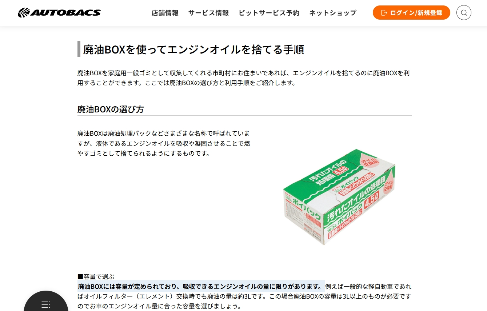
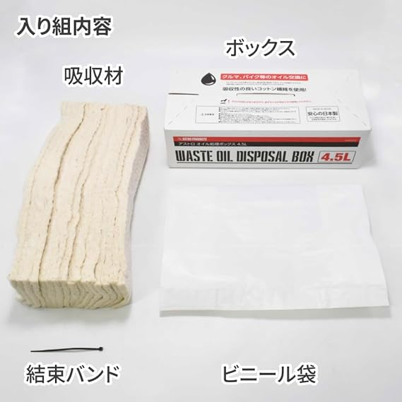
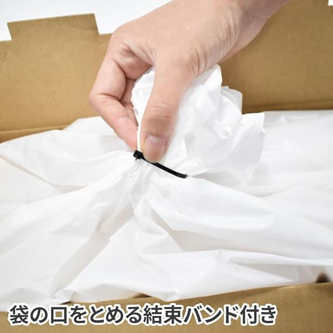

Para os entusiastas de carros e motos que apreciam a manutenção "Faça Você Mesmo" (DIY), escolher um bom óleo sintético, soltar o bujão do cárter e rosquear um filtro novo não significa apenas economizar na mão de obra: proporciona também um contato direto com o estado mecânico do veículo. No entanto, após guardar as ferramentas, muitos se deparam com o grande dilema: **"Onde vou descartar esse óleo preto usado?"**

Antigamente, qualquer oficina de bairro ou posto de gasolina permitia despejar o óleo usado em seus tambores. Hoje, surgem placas de "Não recebemos óleo externo". Por que isso aconteceu e como descartar o lubrificante usado de maneira legal, segura e limpa?

*Referência: [Site oficial da AUTOBACS - Guia de descarte de óleo: solidificar, absorver, queimar ou reciclar?](https://www.autobacs.com/static_html/srv/engineoil/article/1031/)*

## A solução japonesa para o DIY: a caixa de absorção e descarte (Waste Oil Box)

O Japão tem uma das culturas de DIY automotivo mais organizadas do mundo. A rede líder [AUTOBACS](https://www.autobacs.com/static_html/srv/engineoil/article/1031/) destaca o método prático e limpo das chamadas "Waste Oil Boxes":

### Quatro componentes estruturais essenciais
Uma caixa coletora de óleo não é uma simples caixa de papelão: cada detalhe atende às condições severas da troca de óleo. Veja o exemplo da caixa [ASTRO PRODUCTS 4.5L](https://www.amazon.co.jp/dp/B0DJTH698N):

*Crédito da imagem: [Amazon.co.jp - Caixa de descarte de óleo 4.5L | ASTRO PRODUCTS](https://www.amazon.co.jp/dp/B0DJTH698N)*

1. **Caixa de papelão rígido (Box)**: Garante firmeza e isolamento térmico, evitando que o calor do óleo atinja o piso e impedindo tombamentos sob o jato do dreno.
2. **Núcleo absorvente de alta densidade (Absorbent Core)**: Composto por multicamadas de fibra de algodão ou polímeros especiais que retêm rapidamente litros de óleo líquido, eliminando o efeito de líquido solto.
3. **Bolsa plástica interna resistente ao calor (Plastic Liner)**: Sacola plástica reforçada e resistente a perfurações que suporta o óleo quente sem derreter.
4. **Abraçadeira de alta tração (Cable Tie)**: **O componente crucial que assegura "zero vazamento e zero cheiro"!**

*Crédito da imagem: [Amazon.co.jp - Detalhes da caixa ASTRO PRODUCTS 4.5L](https://www.amazon.co.jp/dp/B0DJTH698N)*

### Por que a abraçadeira (Cable Tie) é o coração da segurança?

Ao término da drenagem, o saco contém entre 3 e 5 kg de óleo quente e viscoso. Tentar dar um "nó manual" na sacola traz sérios problemas:
* **Microfissuras nas dobras grossas**: O plástico reforçado não se fecha completamente com um nó manual; ao balançar no porta-malas, o óleo escapa pelos vincos.
* **Redução do espaço útil**: O nó manual puxa as laterais do saco para dentro, comprimindo o algodão e forçando o óleo não absorvido para a abertura.
* **Aperto total e vedação hermética**: Com a abraçadeira de nylon, basta retirar o excesso de ar, **torcer o bocal do saco como uma corda** e apertar a abraçadeira firmemente na raiz. Mesmo que a caixa tombe durante o transporte, nenhum vapor ou gota escapará!

| Capacidade | Veículos recomendados | Troca de filtro inclusa |
|:---:|:---:|:---:|
| **2,5 L** | Scooters e motos de baixa/média cilindrada | Capacidade de sobra (motos levam 0,8L a 1,5L) |
| **4,5 L** | Carros 4 cilindros convencionais, compactos, motos de grande porte | Volume ideal para motores comuns |
| **6,5 L** | Motores 6 cilindros, SUVs turbo, carros a diesel | Motores com cárter de grande volume |

> **Observação sobre normas (Japão vs. outros países)**: No Japão, muitos municípios aceitam essas caixas seladas no lixo doméstico incinerável. **Em outros países, as normas ambientais exigem que o óleo lubrificante seja encaminhado para reciclagem e refino especializado (logística reversa).** Por isso, fora do Japão, a principal vantagem dessas caixas é **manter sua garagem limpa e permitir transportar o óleo sem nenhum vazamento** no porta-malas até o posto ou ecoponto credenciado.

## As 4 regras de ouro para o manuseio de óleo usado

1. **Nunca descarte óleo em ralos, bueiros ou no solo**:  
   Um único litro de óleo de motor pode contaminar até um milhão de litros de água potável. Isso configura crime ambiental sujeito a pesadas multas.
2. **Jamais misture fluidos diferentes**:  
   O refino e reciclagem do óleo exigem alta pureza. Nunca adicione **líquido de arrefecimento (etilenoglicol), fluido de freio, gasolina ou água** ao frasco de óleo usado.
3. **Evite recipientes finos (como garrafas de água mineral PET)**:  
   Garrafas de água têm bocal estreito e paredes plásticas finas que amolecem e deformam com o óleo quente, estourando com facilidade no porta-malas do carro.
4. **Descarte correto do filtro de óleo usado**:  
   O filtro de óleo de metal retirado ainda retém bastante lubrificante. Deixe-o escorrer de cabeça para baixo por pelo menos 12 horas antes de destiná-lo à reciclagem de metais.

## Conclusão: realize seu DIY com orgulho e consciência ambiental

Trocar o próprio óleo é uma das atividades mais gratificantes para os apaixonados por automóveis. **"Finalizar o serviço com o descarte correto e limpo" é a verdadeira marca de um entusiasta experiente.** Seja reutilizando a embalagem original de PEAD para entrega na coleta de resíduos ou usando caixas absorventes lacradas com **abraçadeiras plásticas reforçadas**, você economiza dinheiro e mantém o meio ambiente protegido!
