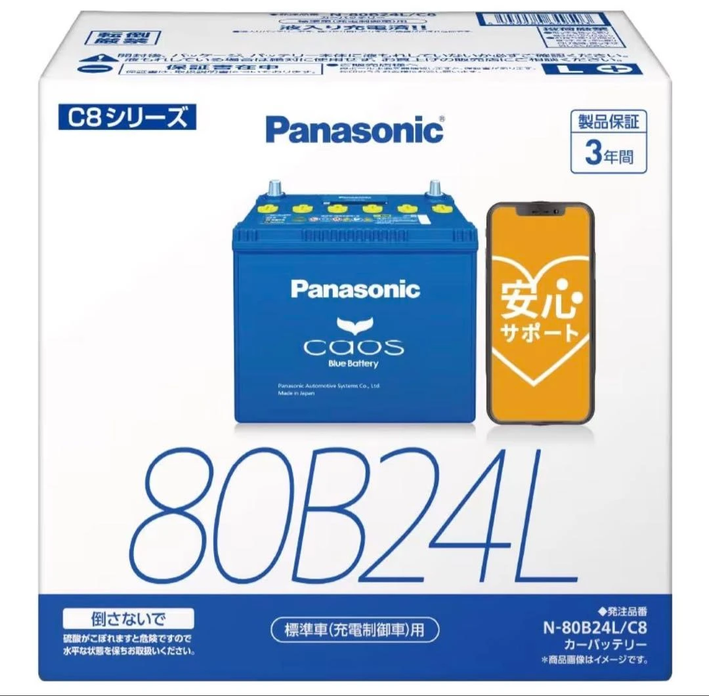

Ao pesquisar ou trocar a bateria de um veículo japonês, é muito comum encontrar códigos alfanuméricos como **`80B24L`** ou **`55D23L`**. Embora pareçam complicados à primeira vista, essas designações seguem rigorosamente o Padrão Industrial Japonês (**JIS D 5301**). Cada caractere descreve com extrema precisão a capacidade elétrica e as dimensões físicas da bateria. Confira a seguir o significado de cada elemento.

---

## 1. Decodificando os códigos de modelos japoneses: o exemplo "80B24L"

A especificação JIS padroniza a designação do modelo da bateria em quatro blocos essenciais:

| Exemplo | Designação | Significado e explicação técnica |
| :---: | :--- | :--- |
| **80** | **Rank de Desempenho** | Números maiores indicam maior potência de partida e capacidade de reserva elétrica. |
| **B** | **Código de Largura e Altura** | Especifica as dimensões transversais padronizadas (largura e altura da caixa). |
| **24** | **Comprimento da Caixa** | Representa um comprimento aproximado de **24 cm** ($$240\text{ mm}$$). |
| **L** | **Posição do Polo Positivo** | Indica que o terminal positivo (+) fica no lado **Esquerdo** (Left). |

---

### Detalhamento de cada bloco

1. **Rank de Desempenho (ex.: 80)**
   * Trata-se de uma pontuação composta que avalia a saída elétrica geral e a força de partida. Um número maior representa partida mais ágil e maior estabilidade de tensão.
   * Na hora da troca, o proprietário pode optar pelo valor original de fábrica ou **fazer um upgrade para um número superior** (por exemplo, subindo de 46 para 60 ou 80) para suportar melhor os acessórios elétricos do veículo.

2. **Código de Perfil da Caixa (ex.: B)**
   * As letras definem larguras e alturas padronizadas:
     * **B**: Largura aprox. $$129\text{ mm}$$, altura aprox. $$203\text{ mm}$$.
     * **D**: Largura aprox. $$173\text{ mm}$$, altura aprox. $$204\text{ mm}$$.
   * **Atenção**: Esta letra determina diretamente se a bateria cabe na bandeja e sob o suporte de fixação original do cofre do motor. Nunca a altere de forma aleatória.

3. **Comprimento da Caixa (ex.: 24)**
   * Indica o comprimento longitudinal externo aproximado em centímetros (**24 cm / $$240\text{ mm}$$**).
   * Como a bandeja do compartimento do motor possui limites fixos, o comprimento deve ser compatível com o suporte do veículo.

4. **Polaridade dos Terminais (ex.: L ou R)**
   * **Regra de visualização**: Olhe para a bateria de frente, com os bornes mais próximos do seu peito:
     * **L** (Left): O terminal positivo (+) está à **esquerda**.
     * **R** (Right): O terminal positivo (+) está à **direita**.
   * **Aviso crítico**: Os cabos originais do carro são dimensionados sem folgas excessivas. Se você comprar a polaridade invertida, os cabos não alcançarão os polos opostos, tornando a montagem impossível.

---

## 2. Conhecimento técnico avançado: como é calculado o Rank de Desempenho?

Pela norma JIS D 5301, o número inicial (como 50 ou 80) não é uma simples marca de marketing. Ele é calculado matematicamente pela seguinte fórmula e arredondado para o inteiro mais próximo:

$$\text{Rank de Desempenho} = \sqrt{\text{CCA} \times \text{RC} \times 0.28}$$

A fórmula combina duas métricas basilares: o **CCA** e a **RC**:

* **Corrente de Partida a Frio (CCA - Cold Cranking Amperes)**:
  * **Definição**: A corrente máxima que a bateria consegue fornecer a **$$0^\circ\text{F}$$ (aprox. $$-17,8^\circ\text{C}$$)** sob frio extremo mantendo uma voltagem operacional segura.
  * **Importância**: Reflete o vigor do arranque nas partidas matinais ou no inverno severo.
* **Capacidade de Reserva (RC - Reserve Capacity)**:
  * **Definição**: O número de minutos que uma bateria consegue descarregar uma corrente constante de **$$25\text{ A}$$ a $$25^\circ\text{C}$$** antes que sua tensão caia para $$10,5\text{ V}$$.
  * **Importância**: Reflete a autonomia em caso de falha do alternador ou ao utilizar acessórios com o motor desligado.

---

## 3. Diretrizes práticas para compra e substituição

1. **Dimensões físicas devem ser idênticas (Letra + Comprimento)**: Padrões como `B24` ou `D23` não aceitam adaptações fáceis; dimensões erradas não fixarão na bandeja de fábrica.
2. **Nunca erre a polaridade dos bornes (L vs. R)**: Abra o capô e confira a posição do polo positivo da sua bateria atual antes de encomendar uma nova.
3. **O Rank de Desempenho pode ser melhorado com segurança**: Se o veículo conta com câmeras de painel (dashcams), sistemas de som potentes ou outros acessórios que consomem energia, escolher um rank maior no mesmo tamanho físico (ex.: migrar de `46B24L` para `80B24L`) traz muito mais durabilidade e tranquilidade.
