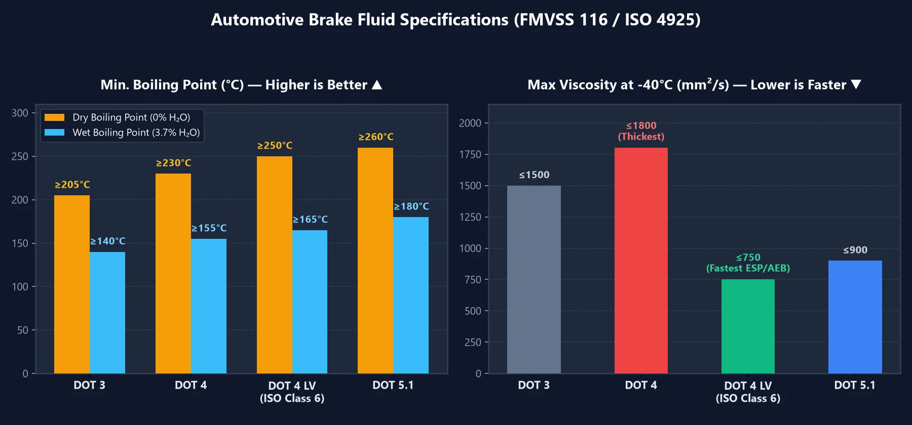

Ao fazer a revisão do carro, é muito comum encontrar frascos de fluido de freio com as siglas **`DOT 3`**, **`DOT 4`**, **`DOT 4 LV`** ou **`DOT 5.1`**. Será que um número maior representa sempre maior desempenho? E por que mecânicos experientes insistem em trocar o fluido a cada 2 anos, mesmo se você quase não rodar? Confira o guia definitivo sobre especificações e segurança do sistema de freios.

---

## 1. Tabela comparativa de fluidos de freio: os 3 índices fundamentais

Ao escolher o fluido de freio correto, você deve analisar três dados cruciais:
1. **Ponto de Ebulição Seco**: Temperatura máxima de tolerância térmica do fluido novo e recém-aberto ($$0\%$$ de teor de água).
2. **Ponto de Ebulição Úmido**: Ponto de ebulição após cerca de 1 a 2 anos de uso real (**$$3,7\%$$ de teor de água**)—**este é o número real de segurança em condições de estrada**.
3. **Viscosidade Cinemática em Baixa Temperatura**: Números mais **baixos** indicam fluido mais ágil e resposta ultrarrápida dos sistemas ABS, ESP e AEB.

| Especificação | Ponto de Ebulição Seco (Novo) | Ponto de Ebulição Úmido (3,7% Água) | Viscosidade Máx a $$-40^\circ\text{C}$$ | Características e Aplicações |
| :---: | :---: | :---: | :---: | :--- |
| **DOT 3** | $$\ge 205^\circ\text{C}$$ | $$\ge 140^\circ\text{C}$$ | $$\le 1500\text{ mm}^2/\text{s}$$ | Comum em carros populares antigos e veículos asiáticos; absorve água mais lentamente, mas ferve mais cedo. |
| **DOT 4** | $$\ge 230^\circ\text{C}$$ | $$\ge 155^\circ\text{C}$$ | $$\le 1800\text{ mm}^2/\text{s}$$ | Suporta mais temperatura que o DOT 3, porém **é mais espesso e viscoso a baixas temperaturas**. |
| **DOT 4 LV** **(Classe 6)** | $$\ge 250^\circ\text{C}$$ | $$\ge 165^\circ\text{C}$$ | **$$\le 750\text{ mm}^2/\text{s}$$** | **A melhor escolha moderna!** Alto ponto de ebulição + máxima fluidez; indispensável para carros com ESP/AEB. |
| **DOT 5.1** | $$\ge 260^\circ\text{C}$$ | $$\ge 180^\circ\text{C}$$ | $$\le 900\text{ mm}^2/\text{s}$$ | Fluido de alta performance para condução esportiva em serras e veículos de carga pesada. |
| **DOT 5** | $$\ge 260^\circ\text{C}$$ | **(Não higroscópico)** | $$\le 900\text{ mm}^2/\text{s}$$ | **Base de silicone (uso militar/colecionadores)**; **estritamente proibido** em carros comuns com ABS! |

> **Por que o `DOT 4 LV` (`ISO 4925 Classe 6`) é a maior recomendação hoje?**  
> Embora o `DOT 4` padrão suporte mais temperatura que o `DOT 3`, ele é visivelmente mais espesso. Os carros modernos contam com **ESP (Controle Eletrônico de Estabilidade)** e **AEB (Frenagem Autônoma de Emergência)**, que precisam pulsar fluido por válvulas microscópicas em milissegundos. Atualizar para o **`DOT 4 LV`** garante pressurização imediata nas situações de risco!

---

## 2. Por que trocar o fluido regularmente? O perigo do "Vapor Lock"

Muitos motoristas se perguntam: **"O circuito de freio não é fechado? Como a água entra no sistema?"**

Na prática, a umidade do ar atmosférico penetra 24 horas por dia através dos microporos dos quatro **flexíveis de borracha** das rodas e das vedações das pinças. Os fluidos de freio comuns (DOT 3 / 4 / 5.1) são formulados propositalmente para serem **higroscópicos (absorvem água)**:
- **Por que absorver água em vez de repeli-la?** Se o fluido repelisse a água (como o DOT 5 de silicone), as gotas se acumulariam no ponto mais baixo e quente: as **pinças de freio**. Lá, essas gotas de água pura ferveriam a meros $$100^\circ\text{C}$$, oxidando pistões e válvulas de dentro para fora. Ao diluir e dissolver a água uniformemente em toda a sua estrutura de éter de glicol, o fluido evita a fervura a $$100^\circ\text{C}$$, mas **tem seu ponto de ebulição geral rebaixado com o passar do tempo**.

### O que é a falha por "Vapor Lock"?

- **Estado Normal (Líquidos são incompressíveis)**: Quando você pisa no pedal de freio, o fluido transmite $$100\%$$ da força do seu pé diretamente aos pistões das pinças de freio.
- **Falha por Vapor Lock (Gases são compressíveis)**: Quando o fluido contaminado (com mais de $$3\%$$ de água, e ponto de ebulição caindo para perto de $$140^\circ\text{C}$$) enfrenta frenagens repetidas em uma longa descida de serra, o calor brutal dos discos faz o fluido dentro da pinça **ferver e gerar bolhas de vapor**. Como o gás se comprime, pisar no freio apenas aperta as bolhas de ar sem empurrar as pastilhas: **o pedal vai até o fundo do assoalho e o freio falha por completo**!

---

## 3. Três dicas práticas de manutenção e compra

1. **Troque pelo "Tempo", e não apenas pela "Quilometragem"**:  
   A permeação de umidade pelos flexíveis ocorre sem parar, mesmo se o veículo ficar na garagem. Troque o fluido de freio a cada **2 anos ou 40.000 km** (o que ocorrer primeiro).
2. **Não confie apenas em canetas de teste ou sucção do reservatório**:  
   O circuito de freio não circula. A água entra pelas rodas e o calor crítico fica nas **quatro pinças**. Testar apenas o reservatório no capô com uma caneta condutivímetro costuma indicar uma falsa luz verde, enquanto o fluido nas pinças já está saturado. Exija a sangria completa em **todos os sangradores das quatro rodas**.
3. **Qual fluido escolher no upgrade?**  
   Se o manual do seu carro indica `DOT 3` ou `DOT 4`, substitua diretamente por um fluido **`DOT 4 LV` (`ISO 4925 Classe 6`)** de boa marca (como ATE SL.6 ou Bosch ENV6) para obter máxima segurança térmica e maior agilidade dos freios eletrônicos.
