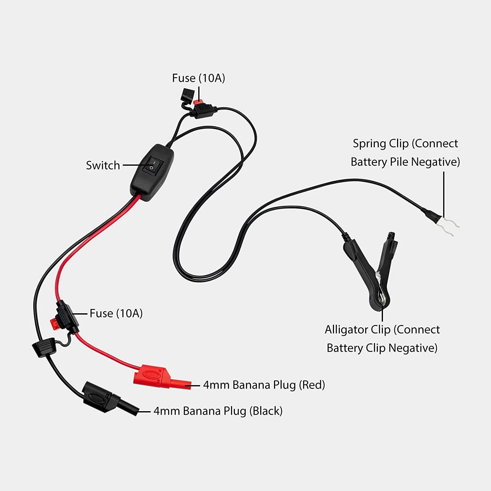
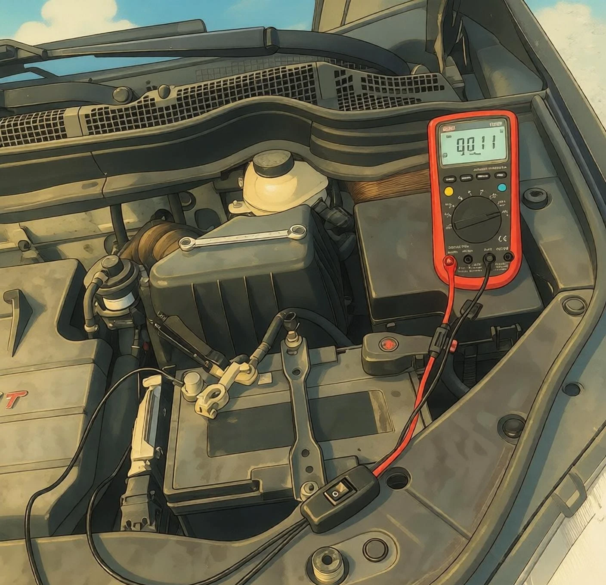

A bateria do seu carro descarrega completamente após ficar estacionado por alguns dias? Você provavelmente está lidando com uma **fuga de corrente parasita (consumo de repouso / dreno de bateria)**.

Nos diagnósticos comuns, medir a corrente em série com o multímetro exige desconectar o terminal negativo da bateria. Contudo, essa desconexão apaga computadores de bordo e códigos do rádio, e o pico de corrente ao reconectar pode **queimar na hora o fusível de 10 A do multímetro**.

A função do **Testador de Fuga de Corrente com Chave Bypass (Parasitic Drain Tester)** é inserir o multímetro em série com total segurança **sem interromper a alimentação elétrica do veículo**, impedindo que picos de corrente danifiquem o multímetro ou desprogramem os módulos.

> 💡 **Navegação da Série:**  
> Se você possui um alicate amperímetro DC com escala de miliampères e prefere um método sem ferramenta nem desmontagem, confira nosso guia complementar:  
> 👉 [Teste de fuga de corrente veicular (Edição Alicate Amperímetro): medindo com alicate DC](/pt/2026/dc-clamp-meter-parasitic-drain-guide.html)

---

## O que é o testador de fuga de corrente com chave bypass?

Esta ferramenta diagnóstica automotiva conta com:

- **Chave seletora de dois caminhos sem interrupção**:
  - **ON (I / Fechado)**: O bypass interno conduz 100% da corrente pelo corpo da ferramenta. O multímetro marca 0 A e absorve com segurança as correntes altas antes do adormecimento.
  - **OFF (O / Aberto)**: O bypass interno se abre, forçando toda a corrente de retorno através dos plugues banana para o multímetro para leitura precisa em miliampères (mA).
- **Garras dedicadas para bateria**: Inclui uma **garra em U com mola** (que se encaixa no polo negativo antes de soltar os cabos) e uma **garra jacaré isolada** (que morde o terminal original).
- **Dois fusíveis de lâmina de 10 A**: Proteção dupla contra sobrecargas acidentais.
- **Plugues banana empilháveis de 4 mm em cobre puro**: Compatíveis com qualquer multímetro automotivo padrão.

---

> [!CAUTION]
> ### ⚠️ Alerta de curto-circuito e queima de multímetro
> **Desligue o motor e remova as chaves antes do teste. NUNCA dê a partida nem ligue a chave na posição ACC/ON durante o teste!**  
> **Não acione cargas pesadas (faróis, vidros elétricos, ar-condicionado, bancos elétricos)**, sob pena de gerar dezenas ou centenas de ampères e destruir os fusíveis e o multímetro.

---

## Procedimento Operacional Padrão (SOP)

### Passo 1: Preparação do veículo e travamento simulado do capô
1. Desligue o motor, apague as luzes internas e remova a chave de ignição.
2. **Abra totalmente os quatro vidros** (essencial para evitar trancamento acidental com as chaves dentro).
3. Abra o capô. Com uma chave de fenda, empurre a trava do capô para baixo até a posição **"fechada / travada"**. Isso engana a central de alarme, simulando o capô fechado.

---

### Passo 2: Confirmar chave do testador em ON (Fechado / Bypass)
Antes de ligar qualquer cabo, certifique-se de que a chave do testador está em **ON (I / Fechado)**. A ferramenta estará em curto interno, conduzindo a corrente por seus próprios cabos robustos e não pelo multímetro.

---

### Passo 3: Fixar as garras no terminal negativo da bateria
1. Prenda com firmeza a **garra em U** na base metálica do **polo negativo da bateria**.
2. Prenda a **garra jacaré isolada** diretamente no **terminal metálico do cabo negativo original**.

---

### Passo 4: Conectar o multímetro
1. Encaixe o plugue banana preto de 4 mm na entrada **COM** do multímetro.
2. Encaixe o plugue banana vermelho na entrada de corrente alta **10A / 20A** (nunca inicie na entrada de mA).
3. Gire o seletor para **Corrente Contínua (DC A)**.

---

### Passo 5: Soltar e isolar o terminal negativo original
1. Com uma **chave 10 mm**, afrouxe a porca do terminal negativo original da bateria.
2. Levante cuidadosamente o terminal para fora do polo (a alimentação do veículo permanece ininterrupta através do testador).
3. **Coloque um pedaço de papelão grosso ou plástico entre o terminal e o polo da bateria** para impedir qualquer contato metálico acidental.

---

### Passo 6: Trancar o veículo e aguardar repouso profundo (15 a 45 minutos)
1. Feche todas as portas e pressione o botão da chave para trancar o carro.
2. **Afaste as chaves de presença (Keyless) a pelo menos 5 metros de distância** para evitar comunicação por proximidade.
3. Aguarde de **15 a 45 minutos** para que todas as centrais (ECU, BCM, gateway) concluam as rotinas de desligamento e entrem em modo sleep profundo.

---

### Passo 7: Mudar chave para OFF e ler a corrente de fuga
1. Certifique-se de que o multímetro continua ligado.
2. Mude a chave do testador para **OFF (O / Aberto)**.
3. O bypass se abre, direcionando toda a corrente pelo multímetro. Leia a corrente parasita estabilizada na tela.

> [!TIP]
> **Mudando para escala de alta resolução (escala mA):**  
> Se o consumo for baixo e você desejar a precisão da escala de mA, **sempre retorne a chave do testador para ON (Fechado)** antes de girar o seletor do multímetro ou trocar as pontas de prova, e depois **retorne para OFF**. Jamais troque a escala do multímetro com a chave na posição OFF!

| Leitura (DC Amps) | Condição | Diagnóstico e Ação |
| :--- | :--- | :--- |
| **20 mA - 60 mA (0,02 A - 0,06 A)** | ✅ **Normal** | Consumo padrão de alarme e memória de relógio; a bateria dura semanas. |
| **60 mA - 80 mA (0,06 A - 0,08 A)** | ⚠️ **Pouco Elevado** | Verifique acessórios em standby (ex.: dashcam com modo estacionamento). |
| **> 80 mA (ou centenas de mA)** | ❌ **Fuga Crítica** | Dreno severo que descarrega a bateria em dias; inicie a busca pelos fusíveis! |

---

## Técnica diagnóstica por remoção de fusíveis

Se a corrente parasita ultrapassar **60 mA**, mantenha o testador em OFF e localize o circuito problemático:

1. **Localize as caixas de fusíveis**: No cofre do motor, sob o painel ou no porta-malas.
2. **Remova um fusível por vez**: Use o extrator plástico e retire **apenas um fusível por vez** observando o visor do multímetro.
3. **Identifique o culpado**:
   - Se a leitura não mudar, **recoloque o fusível no lugar** e passe para o seguinte.
   - Quando a remoção de um fusível fizer a corrente **despencar para menos de 50 mA**, aquele circuito é a causa da fuga!
4. **Causas mais comuns**:
   - Conversores de tensão de dashcams instalados no positivo direto (corte de subtensão defeituoso).
   - Centrais multimídia Android ou amplificadores (linha ACC que não desliga).
   - Microinterruptores de fechaduras de portas danificados (impedindo o adormecimento do módulo de carroceria).
   - Luzes de porta-luvas ou porta-malas que não apagam.

---

## Procedimento de desmontagem segura (SOP)

Siga rigorosamente a ordem para evitar faíscas ou perda de memória da central:

1. **Retornar para ON**: Mude a chave do testador para **ON (I / Fechado)**.
2. **Desconectar o multímetro**: Retire os plugues banana do multímetro.
3. **Reinstalar o terminal negativo**: Remova a proteção de papelão, encaixe o terminal original de volta no polo da bateria e aperte a porca com a chave de 10 mm.
4. **Remover as garras do testador**: Após apertar o terminal original, remova a garra em U e a garra jacaré.
5. **Liberar a trava do capô**: **Nunca bata o capô com a trava engatada!** Puxe a alavanca interna de abertura do capô na cabine para destravar o mecanismo antes de fechar o capô normalmente.
