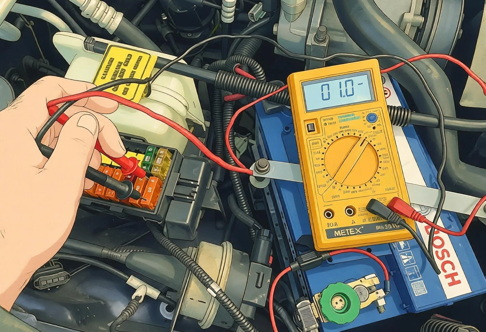
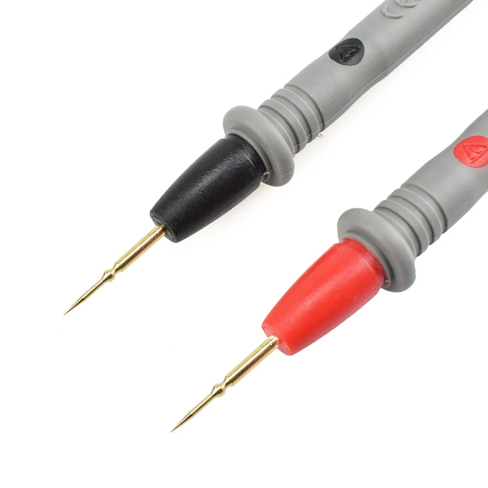

Ao investigar uma bateria que descarrega misteriosamente durante a noite, a clássica rotina de sacar fusíveis um a um costuma se transformar em uma armadilha. Em veículos modernos equipados com redes de comunicação CAN-bus, retirar um fusível **desperta imediatamente as centrais eletrônicas**, gerando picos de consumo que invalidam todo o teste.

O **Método da Queda de Tensão em Fusíveis (utilizando a Tabela de Fusíveis em mV)** é a técnica padrão dos melhores especialistas em diagnóstico: **100% livre de puxar fusíveis, sem interrupção de energia e sem despertar módulos**. Com um multímetro digital comum, você inspeciona uma caixa de fusíveis inteira em menos de dois minutos e localiza o circuito em fuga com precisão cirúrgica.

> **Navegação da Série:**
> - Para medir o consumo de repouso total: [Guia da Chave em Série](/pt/2026/parasitic-drain-tester-guide.html) | [Guia do Alicate Amperímetro DC](/pt/2026/dc-clamp-meter-parasitic-drain-guide.html)

---

## Princípio Fundamental: A Lei de Ohm $$V = I \times R$$

Os fusíveis de lâmina automotivos não são condutores perfeitos de resistência zero. Seu filamento interno possui uma resistência metálica minúscula, calibrada e estável (geralmente entre 2 mΩ e 30 mΩ).

Pela **Lei de Ohm**:

$$V = I \times R \quad \Longrightarrow \quad I = \frac{V}{R}$$

- $$R$$ (Resistência Interna do Fusível): Fixa e conhecida com base no tipo e na amperagem do fusível.
- $$V$$ (Queda de Tensão): A micropotencial medida entre os terminais do fusível em milivolts ($$mV$$).
- $$I$$ (Corrente Parasita): A corrente real circulando pelo circuito em miliampères ($$mA$$).

Os fusíveis de lâmina contam com **dois pontos de teste metálicos expostos** no topo. Ao encostar as pontas de prova do multímetro nesses pontos, mede-se a diferença em milivolts ($$mV$$) diretamente, sem desconectar nada.

---

## Ferramentas Necessárias

1. **Multímetro Digital (DMM)**: Ajustado na escala de **DC mV (milivolts)** (com resolução de 0,1 mV ou 0,01 mV).
2. **Pontas de Prova Finas Tipo Agulha (Indispensáveis)**: As pontas comuns são muito grossas para os furos dos fusíveis. Pontas agulha de 0,7 mm a 1,0 mm perfuram o óxido superficial com perfeição.
3. **Tabela de Referência**: As tabelas abaixo.

---

## Procedimento Passo a Passo

### Passo 1: Simular travamento e aguardar o sono profundo
1. Desligue a ignição, apague todos os acessórios e **abra totalmente os vidros** (para não ficar trancado para fora).
2. Abra as tampas das caixas de fusíveis e **trave manualmente as fechaduras (portas, capô e porta-malas)** com uma chave de fenda para simular carro trancado.
3. Trave o veículo pelo controle remoto e **afaste as chaves presenciais a mais de 5 metros**.
4. **Aguarde de 15 a 45 minutos** para que todas as centrais (BCM, ECU, gateway) entrem em repouso profundo.

---

### Passo 2: Configurar o multímetro e medir
1. Conecte a ponta vermelha em **V/Ω/mV** e a preta em **COM**.
2. Gire o seletor para a escala **DC mV**.
3. Pressione com firmeza as pontas de prova nos **dois pontos de teste metálicos** no topo do fusível, aplicando leve pressão para furar a película de oxidação.
4. Observe o display:
   - **`0.0 mV`**: Nenhuma corrente circulando. O circuito está dormindo; passe imediatamente para o próximo fusível.
   - **Valor numérico (ex.: `0.6 mV`)**: Há corrente ativa passando por este fusível! Anote o formato do fusível (Mini ou Padrão/ATO), a amperagem e o valor em mV.

> **Leitura com sinal negativo (ex.: -0,5 mV)?**  
> Isso reflete apenas o lado em que a ponta vermelha encostou. Fusíveis não têm polaridade: **utilize o valor absoluto (`0,5 mV`)** para ler a tabela.

---

## Tabelas de Referência: Queda de Tensão em Fusíveis

Após medir a voltagem em milivolts, consulte as tabelas abaixo para identificar a corrente de fuga em miliampères (mA):

### 1. Tabela para Fusíveis Mini (ATM) (Unidade: mA)

| Amperagem | Resistência Aprox. | 0,2 mV | 0,4 mV | 0,6 mV | 0,8 mV | 1,0 mV | 1,5 mV | 2,0 mV |
| :--- | :--- | :--- | :--- | :--- | :--- | :--- | :--- | :--- |
| **5A (Bege)** | ~15,2 mΩ | 13 mA | 26 mA | 39 mA | 53 mA | **66 mA** | 99 mA | 132 mA |
| **7,5A (Marrom)** | ~10,1 mΩ | 20 mA | 40 mA | 59 mA | 79 mA | **99 mA** | 149 mA | 198 mA |
| **10A (Vermelho)** | ~7,1 mΩ | 28 mA | 56 mA | 85 mA | 113 mA | **141 mA** | 211 mA | 282 mA |
| **15A (Azul)** | ~4,6 mΩ | 43 mA | 87 mA | 130 mA | 174 mA | **217 mA** | 326 mA | 435 mA |
| **20A (Amarelo)** | ~3,3 mΩ | 61 mA | 121 mA | 182 mA | 242 mA | **303 mA** | 455 mA | 606 mA |
| **25A (Branco/Transp.)**| ~2,5 mΩ | 80 mA | 160 mA | 240 mA | 320 mA | **400 mA** | 600 mA | 800 mA |
| **30A (Verde)** | ~2,0 mΩ | 100 mA | 200 mA | 300 mA | 400 mA | **500 mA** | 750 mA | 1000 mA |

---

### 2. Tabela para Fusíveis Padrão (ATO / ATC) (Unidade: mA)

| Amperagem | Resistência Aprox. | 0,2 mV | 0,4 mV | 0,6 mV | 0,8 mV | 1,0 mV | 1,5 mV | 2,0 mV |
| :--- | :--- | :--- | :--- | :--- | :--- | :--- | :--- | :--- |
| **5A (Bege)** | ~17,8 mΩ | 11 mA | 22 mA | 34 mA | 45 mA | **56 mA** | 84 mA | 112 mA |
| **7,5A (Marrom)** | ~10,9 mΩ | 18 mA | 37 mA | 55 mA | 73 mA | **92 mA** | 138 mA | 183 mA |
| **10A (Vermelho)** | ~7,4 mΩ | 27 mA | 54 mA | 81 mA | 108 mA | **135 mA** | 203 mA | 270 mA |
| **15A (Azul)** | ~4,8 mΩ | 42 mA | 83 mA | 125 mA | 167 mA | **208 mA** | 313 mA | 417 mA |
| **20A (Amarelo)** | ~3,4 mΩ | 59 mA | 118 mA | 176 mA | 235 mA | **294 mA** | 441 mA | 588 mA |
| **25A (Branco/Transp.)**| ~2,6 mΩ | 77 mA | 154 mA | 231 mA | 308 mA | **385 mA** | 577 mA | 769 mA |
| **30A (Verde)** | ~2,1 mΩ | 95 mA | 190 mA | 286 mA | 381 mA | **476 mA** | 714 mA | 952 mA |

> **Cálculo mental rápido (Fusível Mini 10A muito comum):**  
> **Cada 0,1 mV de queda corresponde a aproximadamente 14 mA de fuga.** Uma leitura de `0,5 mV` equivale a $$0,5 \times 14 = 70\text{ mA}$$.

---

## Isolando o componente com defeito

Ao encontrar um fusível com queda de tensão ativa, **não o remova**:

1. **Consulte a função do fusível**: Olhe no manual do proprietário ou no diagrama da tampa para ver quais aparelhos ele alimenta (ex.: som multimídia, módulo de alarme, luzes de cortesia, módulo de portas).
2. **Desconecte o aparelho suspeito**: Solte o conector elétrico direto na peça (e não na caixa de fusíveis).
3. **Meça a queda de tensão novamente**: Se a leitura despencar imediatamente de `1,2 mV` para **`0,0 mV`**, você descobriu o consumidor pirata com 100% de certeza!

---

## Resumo do fluxo diagnóstico em 3 passos

* **Passo 1 (Checagem Geral)**: Abrace o cabo negativo com o alicate amperímetro DC por 30 segundos para confirmar se há dreno (< 50 mA é normal).
* **Passo 2 (Checagem do Alternador)**: Abrace o cabo B+ do alternador para descartar fuga por diodos retificadores danificados.
* **Passo 3 (Diagnóstico Cirúrgico)**: Teste os fusíveis com o multímetro em **DC mV** usando a tabela de queda de tensão para achar o circuito culpado em 2 minutos sem acordar o veículo!
