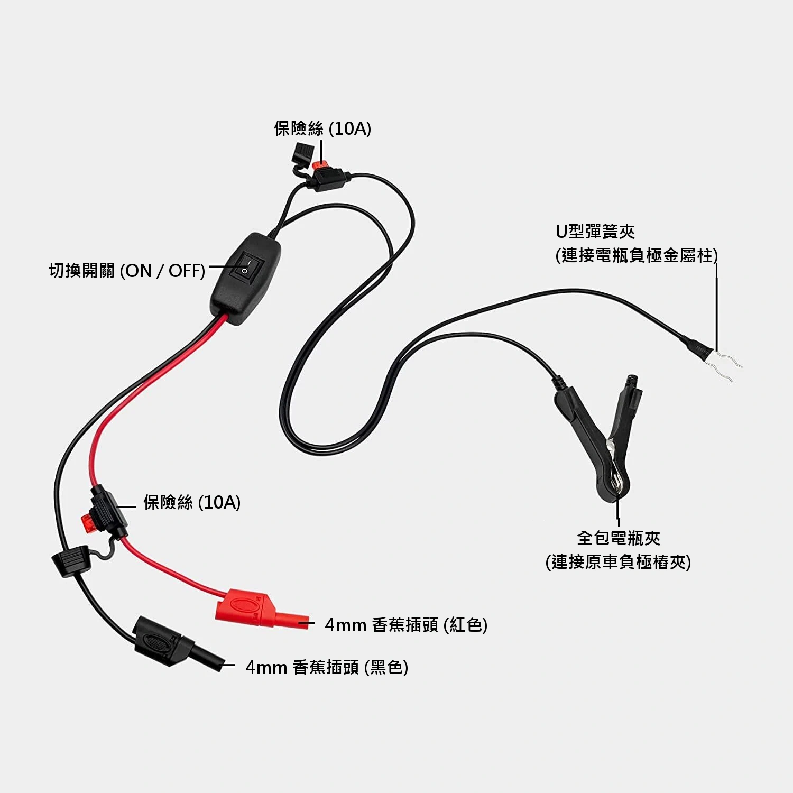

用三用電表測量汽車暗電流（漏電）時，若直接拆開負極串聯電表，斷開瞬間會造成行車電腦重設，重新接通時湧入的充電突波更會**直接燒毀電表內部的保險絲**。

**「暗電流測試工具（Bypass Switch 旁路開關）」**的核心價值，就是在**全程不斷電、無突波**的前提下，安全將三用電表接入電路，精準讀取車輛深度休眠後的總暗電流。

> **系列導讀：**
> - 想免拆卸任何螺絲進行非接觸式快速檢測，請參考：[勾表篇（直流勾表量測）](/2026/dc-clamp-meter-parasitic-drain-guide.html)
> - 想完全免拔保險絲、不吵醒電腦進行分路秒速排查，請參考：[壓降篇（保險絲微電壓降查表法）](/2026/fuse-voltage-drop-parasitic-drain-guide.html)

---

## 工具構造與工作原理

這套工具本質上是一個**不斷電旁路切換開關**：
- **ON 檔位（閉合導通）**：全車電流直接走工具金屬結構，不經過電表，安全承載鎖車及休眠前的瞬間大電流。
- **OFF 檔位（斷開旁路）**：切斷直通線路，電流被強制分流進入三用電表，讀取精確電流。
- **雙夾具設計**：內側 U 形彈簧夾緊扣電瓶負極金屬樁柱，外側全包夾牢牢夾持原車負極樁夾（搭鐵端子）。

> **安全嚴正警告：**  
> 測試全程**嚴禁發動引擎或開啟電門（ACC / ON）**，亦嚴禁開啟大燈、冷氣或音響，否則瞬間數十安培電流會直接燒毀電表或測試儀保險絲！

---

## 標準量測步驟（SOP）

### 步驟 1：偽裝門鎖與車輛準備
1. 熄火、關閉全車燈光電器、拔出鑰匙。
2. **四門車窗全部降到底**（防止測試中途防盜意外反鎖）。
3. 打開引擎蓋，用螺絲起子手動將引擎蓋鎖扣卡入**「閉合鎖定」**，使防盜系統認定引擎蓋已關閉。

---

### 步驟 2：安裝測試儀與連接電表
1. **確認開關撥至 ON 檔位（閉合導通）**。
2. 將工具的 **U 形彈簧夾** 緊夾在**電瓶負極金屬柱**底部。
3. 將工具的 **全包電瓶夾** 夾在**原車負極樁夾**上。
4. 電表黑色表筆接 **COM**，紅色表筆接 **10A / 20A 高電流孔**，檔位旋至 **DC A（直流安培）**。
5. 鬆開原車負極樁夾固定螺母，將原車樁夾拔離金屬柱（此時全車供電由測試工具無縫維持，**完全不斷電**）。
6. **在原車負極樁夾與電瓶柱之間塞入塑膠片或硬紙板絕緣**，避免意外碰觸。

---

### 步驟 3：鎖車休眠與讀取數值
1. 關上所有車門，遙控上鎖，**將智慧鑰匙移至 5 公尺外**。
2. **靜置等待 15 至 45 分鐘**，待全車行車電腦（ECU / BCM）依序進入深度睡眠。
3. 確認電表仍在開機狀態，將測試儀開關撥至 **OFF 檔位（斷開旁路）**。
4. 全車電流改由電表流通，螢幕即時顯示精確的休眠暗電流。

> **切換至 mA 精細檔位的注意須知：**  
> 若要換插至 mA 檔量測微小數值，**務必先將開關切回 ON 檔**，再拔插表筆與切換旋鈕，完成後再切回 OFF 檔，切勿在 OFF 狀態下直接轉動檔位或拔插表筆以防斷路！

---

## 暗電流數值判讀標準

| 讀數範圍 | 狀態評估 | 說明與應對策略 |
| :--- | :--- | :--- |
| **20mA - 60mA (0.02A - 0.06A)** | **正常** | 原廠標準待機電流（防盜接收、時鐘記憶），電瓶可健康存放數週。 |
| **60mA - 80mA (0.06A - 0.08A)** | **偏高** | 常見於加裝行車記錄器駐車縮時、防盜器微耗電。 |
| **> 80mA (甚至數百 mA 以上)** | **異常漏電** | 電瓶數天內就會耗盡無法發動，必須進行分路抓漏排查！ |

---

## 測量完畢復原 SOP

檢測完成後，必須按照嚴格順序復原，以防在拔離時產生斷電火花或電腦資料遺失：

1. **撥回 ON 檔位**：先將測試儀開關撥回 ON 檔。
2. **拔除電表插頭**：拔掉電表上的香蕉插頭。
3. **取出絕緣片並鎖回負極**：抽開隔離片，將原車負極樁夾套回電瓶金屬柱並用扳手鎖緊。
4. **拆下測試夾具**：確認原車接頭已鎖緊後，拆下 U 形夾與全包夾。
5. **釋放引擎蓋鎖扣**：拉動駕駛座內引擎蓋拉柄彈開鎖扣，再正常關閉引擎蓋。

---

## 抓漏下一步：分路定位漏電元兇

若量測出的總暗電流超過 50mA，代表車輛存在異常漏電。在現代配備電腦通訊網路的車輛上，**切勿一顆顆盲目拔保險絲**，否則會喚醒休眠電腦導致排查失準。

推薦直接使用三用電表搭配**「保險絲微電壓降查表法」**，免拔保險絲、不干擾電腦，兩分鐘即可精準抓出漏電迴路！

詳細實戰步驟與換算表請參考：  
[汽車漏電檢測教學（壓降篇）：免拔保險絲！使用三用電表與微電壓降查表法（Fuse Voltage Drop Chart）精準抓漏](/2026/fuse-voltage-drop-parasitic-drain-guide.html)
