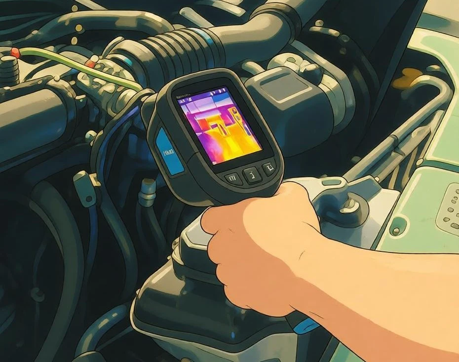
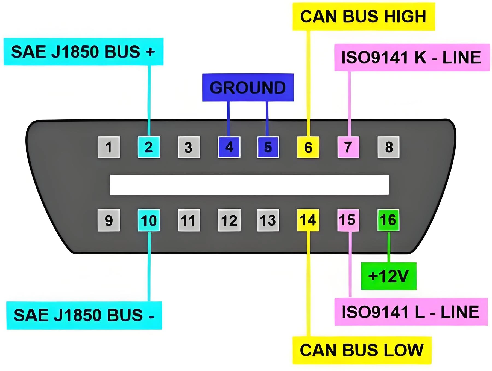

先說在前面：**一般車況只要用前三篇的基礎方法，就能解決 80% 以上的漏電問題**（像是行車記錄器、車內燈或發電機逆流），新手車友完全不用被這篇嚇到！只有當你照著測完總暗電流與保險絲壓降、卻還是卡關找不到兇手時，再來參考這篇的五大進階排查技巧即可。

> **基礎篇回顧：**
> - 總暗電流不斷電量測：[串聯篇（測試工具量測）](/2026/parasitic-drain-tester-guide.html)｜[勾表篇（直流勾表量測）](/2026/dc-clamp-meter-parasitic-drain-guide.html)
> - 免拔保險絲分路定位：[壓降篇（微電壓降查表法）](/2026/fuse-voltage-drop-parasitic-drain-guide.html)

---

## 一、先排除「假性漏電」：電瓶自放電與 IBS 智慧充電

花大把時間抓漏前，先確認不是電瓶本身或充電邏輯造成的誤判：

### 1. 電瓶自放電測試
電瓶老化或內部微短路時，就算斷開全車一樣會自己沒電：
1. 充飽電後**拆開電瓶負極樁夾**，靜置 1 小時待浮電消退，記錄初始電壓（健康滿電約 `12.6V ~ 12.7V`）。
2. 維持斷開靜置 24 小時後再測：電壓下降 `< 0.05V` 代表電瓶正常；若明顯跌落（如掉到 `12.2V` 以下），直接換電瓶即可。

### 2. IBS / BMS 智慧充電造成的「假性虧電」
配備智慧充電系統的現代車，為了節能常態只會把電瓶充到 **75% ~ 80%**。若平時都跑 10～15 分鐘的短途代步，電瓶長期處於低電量邊緣，遇寒流或放幾天就容易發不動。**查漏前，請先用充電器把電瓶充飽並確認 CCA 健康度。**

---

## 二、壓降法全是 `0.0 mV` 卻還在漏電？五大盲區

總暗電流高達數百 mA，但保險絲全測出 `0.0 mV`，代表電流走了壓降法看不見的路徑：

1. **直連大電流迴路（不經刀片保險絲）**：最常見是**發電機 B+ 粗紅線**整流二極體擊穿（詳見[勾表篇](/2026/dc-clamp-meter-parasitic-drain-guide.html)）；其次是直接從電瓶正極供電的**啟動馬達、電子散熱風扇／水泵模組**，以及鎖螺絲的**電瓶正極配電主保險絲（Megafuse / Multi-block Fuse）**。
2. **大安培保險絲（30A ~ 60A+）壓降過低**：內阻極低（常 `< 2 mΩ`），漏電 `100mA` 時壓降可能小於 `0.1mV`，電表容易直接顯示 `0.0 mV`。**解法**：改用 2A 檔位直流勾表夾住背後對應的粗電源線。
3. **無測試孔的盒狀保險絲（JCASE / Maxi）**：頂部封閉無金屬測試點，細針點不到，同樣須改用勾表夾線或熱像儀排查。
4. **漏查隱藏的保險絲盒**：許多車除了引擎室與駕駛座，在**後行李廂側板、後座椅下方、電瓶旁或副駕腳踏墊下**還藏有其他保險絲盒，記得查車主手冊確認全部位置。
5. **後裝改裝品直拉電瓶**：行車記錄器降壓線、音響擴大機、外掛燈具或無線電若直接從電瓶正極拉線，原廠保險絲盒當然測不到。

---

## 三、當場測正常（30mA），放兩天卻沒電：「間歇性幽靈喚醒」

現代車熄火鎖車後，電流會呈階梯式下降（如 `3A` → `0.8A` → `0.03A`）。若現場看已降到 `30mA` 以下，過夜卻還是沒電，通常是半夜被不明訊號反覆喚醒，電流週期性暴衝回 `0.5A ~ 3A`。

**DIY 優先排查這 4 個常見元兇：**
* **Keyless 門把感應器**：洗車或淋雨進水受潮，半夜誤判有人觸摸門把。
* **智慧鑰匙放太近**：車停家門口或車庫，鑰匙放在玄關離車不到 3～5 公尺，導致車輛持續握手通訊。
* **OBD2 外掛裝置**：長期插著的藍牙 HUD、GPS 追蹤器或診斷頭，定時發訊號吵醒電腦（**測試時請一律先拔除**）。
* **車聯網 / SOS 模組**：停在地下室收訊差，主機不斷重連基地台導致無法休眠。

> **進階抓法**：光靠眼睛盯著抓不到半夜喚醒，可借用或購入支援 **Data Logging（資料紀錄）的藍牙三用電表／勾表**，搭配旁路開關（[串聯篇](/2026/parasitic-drain-tester-guide.html)）錄製 12～24 小時曲線，直接看有沒有異常尖峰脈衝。

---

## 四、抓到異常保險絲卻修不好：CAN-BUS 不休眠

現代車的電腦會透過 CAN-BUS / LIN-BUS 互相叫醒。你抓到「儀表板」或「車身電腦（BCM）」吃電 `300mA`，往往不是它壞了，而是**被匯流排上另一個故障零件（例如受潮的雨滴感應器、門把天線等 LIN-BUS 小元件）一直吵醒**。

### 1. 免拆內裝初判：量測 OBD2 確認 CAN-BUS 是否休眠

將三用電表轉至 **DC V（直流電壓）檔**，用細針表筆分兩次量測（勿硬捅撐鬆孔位）：
* **測 CAN-H**：紅表筆點 **Pin 6**，黑表筆點 **Pin 4**（或 Pin 5 搭鐵）。
* **測 CAN-L**：紅表筆改點 **Pin 14**，黑表筆一樣點 **Pin 4**（或 Pin 5）。

判讀標準：
* **深度休眠**：兩次量測都降至接近 **`0.0V`**。
* **仍在喚醒（Active）**：CAN-H 約 **`2.5V ~ 2.8V`**、CAN-L 約 **`2.2V ~ 2.5V`** 且微幅跳動，代表網路上有模組不肯睡。

> **注意兩件事：**
> 1. **網關隔離限制**：許多新款車配備**中央網關（Gateway / SGW）**，平時會把 OBD2 隔離成 `0.0V`，就算車身網路沒休眠也量不出來，須改量車身 **CAN 分配器（CAN Hub）**。
> 2. **切勿轉錯檔位**：量測 OBD2 嚴禁使用電阻檔或電流檔，以免燒毀通訊晶片。

### 2. 進階隔離：拔「通訊線」不拔「保險絲」
確認網路沒睡時，可在監控總暗電流的狀態下，找到車上的 **CAN 匯流排分配器（CAN Hub）**，逐一拔除各節點插頭（只斷通訊不斷電）。拔到哪一顆後電壓歸零、暗電流在數十秒內掉回 `30mA` 以下，該節點就是真兇。

---

## 五、視覺化降維打擊：紅外線熱像儀

當線束狹窄難量，或懷疑地毯下、車門內受潮漏電時，手機外掛式熱像儀是 DIY 神器。只要元件持續漏電 `100mA ~ 300mA` 以上（如微導通晶片、持續通電吸合的繼電器線圈、接觸不良接點或氧化線束），溫度就會比周圍高出 **2°C ～ 5°C**。

* **實戰要點**：務必等全車徹底冷卻（熄火靜置 **2～3 小時以上**或放過夜）再掃描；重點看保險絲盒、繼電器、易積水處（天窗排水孔下方、地毯下、備胎槽）與加裝品；判讀時避開裸露亮面金屬，以免反射周圍熱源造成誤判。

---

## 六、DIY 進階抓漏總決策清單

1. **排除電瓶**：斷開負極靜置 24 小時測電壓，先確認不是電瓶自放電或 IBS 短途未充飽。
2. **拔除外掛**：拔掉所有 OBD2 裝置、點菸器設備，並把智慧鑰匙拿遠。
3. **總流與壓降**：用[直流勾表](/2026/dc-clamp-meter-parasitic-drain-guide.html)測總暗電流與發電機 B+，再用[壓降法](/2026/fuse-voltage-drop-parasitic-drain-guide.html)掃描全車保險絲盒（含隱藏盒）。
4. **全車 `0.0 mV`**：轉查直連迴路（發電機、風扇、啟動馬達）、大安培／盒狀保險絲（改用勾表夾線）與改裝件直拉線。
5. **會睡著但隔天沒電**：架設記錄型電表錄過夜曲線，抓間歇性喚醒（重點查 Keyless 門把、車聯網）。
6. **抓到迴路卻修不好**：測 OBD2 Pin 6/14（或 CAN Hub）確認網路是否不休眠，並搭配熱像儀掃描發熱點。